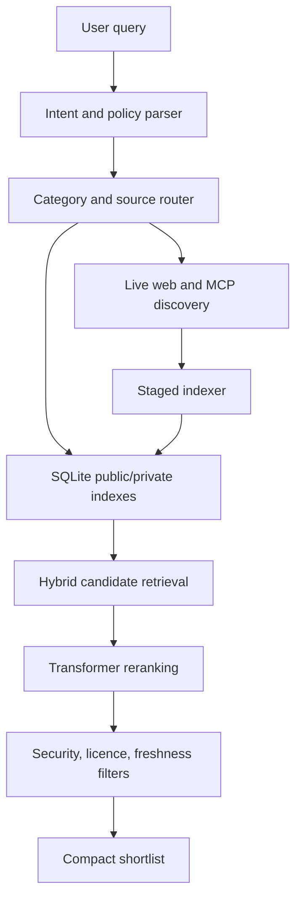

# Everything Skill — Architecture

## System shape



## Repository layout

```text
everything-skill/
├── SKILL.md
├── README.md
├── database/
│   ├── public/
│   ├── migrations/
│   └── seeds/
├── schemas/
├── security/
├── review-queue/
├── adapters/
├── exports/
├── demo/
├── tests/
├── docs/
└── package.json
```

## Index model

Use SQLite as the primary store with stable schemas and forward-compatible migrations. Keep public and private data logically separate.

Core entities:

- `resources`: canonical identity, type, title, source, licence, status, score inputs.
- `resource_versions`: commit/tag/version hash, scan state, changed files, freshness.
- `capabilities`: structured inputs, outputs, permissions, dependencies, categories.
- `evidence`: source URL, evidence type, retrieval time, permitted summary, confidence.
- `relationships`: duplicates, alternatives, replacements, dependencies, MCP wrappers.
- `security_scans`: append-only findings and decisions.
- `review_items`: suggestions, update reviews, duplicate tallies, maintainer actions.
- `preferences`: global, topic, and project scopes.
- `overrides`: whitelist/blacklist scope and warning acknowledgement.
- `private_discoveries`: user-only resources and generated adapters.

Indexes should include:

- SQLite FTS5 for names, descriptions, tags, paths, and identifiers;
- metadata indexes for type, category, licence state, maintenance, runtime, cost, security, and status;
- vector index only for candidates requiring semantic retrieval;
- composite indexes matching common filters, such as `(status, resource_type, category)` and `(security_status, licence_status)`;
- partial indexes for active, approved resources;
- hashes and canonical URLs for deduplication.

## Retrieval cascade

1. Parse intent, field, resource type, constraints, and permission policy.
2. Apply hard policy filters and user blacklist.
3. Search exact metadata and FTS5.
4. Search dense embeddings only in the routed category subset.
5. Fuse lexical and semantic results with reciprocal-rank fusion.
6. Rerank a small candidate set with a cross-encoder or late-interaction model.
7. Apply freshness, licence, security, compatibility, and cost checks.
8. Produce structured evidence cards, not raw document dumps.

## Live discovery and staged indexing

Use public GitHub APIs, official MCP registries, curated catalogues, academic indexes, and web search where permitted. Register a source first, then index:

1. source metadata and licence signals;
2. structure, headings, categories, links, manifests, and summaries;
3. only the sections relevant to the current query;
4. deeper content for promising candidates;
5. private cache entries with provenance and freshness.

## Security pipeline

```text
fetch -> isolate -> normalise -> detect injection -> inspect dependencies
      -> inspect permissions -> check licence -> record evidence
      -> classify -> allow / warn / hard-block -> append audit record
```

Hard-block findings cannot be bypassed by user overrides. Prompt-injection reports contain safe redacted summaries, never the exact suspicious text.

## Update and rollback

Public index releases are immutable versions. The user explicitly selects an update. Install beside the current version, migrate private data independently, validate, then allow switching or rollback. Automated monitoring creates update-review items for user-impacting changes; harmless metadata refreshes need not change the public resource page.

## Generated MCP adapters

Generated adapters are private by default, use least privilege, have no real credentials during automatic tests, and run in a restricted sandbox. Real credentials require secure host secret injection and fresh user confirmation. Public sharing requires maintainer review.
